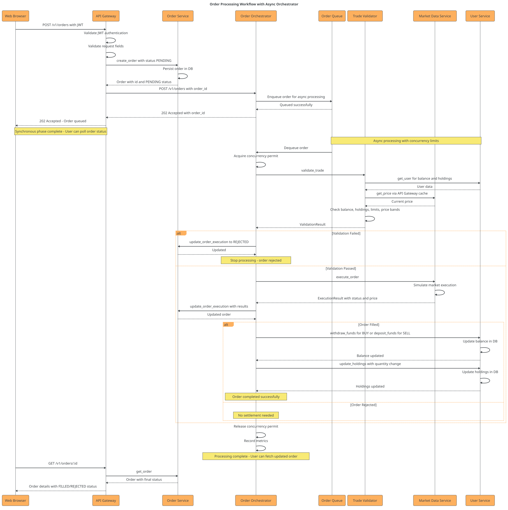

# ADR 004 – Implémentation du traitement des ordres avec saga chorégraphiée

## Statut

Acceptée

## Contexte

Nous devons traiter les ordres de trading de manière asynchrone et fiable dans un environnement distribué. Les exigences sont :

- **Traitement asynchrone** : Accepter immédiatement les ordres, traiter en arrière-plan
- **Cohérence distribuée** : Coordonner validation, exécution et settlement entre services
- **Résilience** : Gérer les pannes et permettre la compensation en cas d'échec
- **Observabilité** : Tracer l'état de chaque ordre dans le pipeline

## Décision

Nous avons implémenté une **saga chorégraphiée** basée sur des événements avec Event Store.

### Architecture de la saga

**Processus en 2 phases** :

1. **Acceptation synchrone** : L'API Gateway persiste l'ordre dans Order Service et répond `202 Accepted`
2. **Traitement asynchrone** : Les services réagissent aux événements Redis de manière autonome

**Étapes de la saga** :

**Chorégraphie (chaque service réagit aux événements)** :

1. **API Gateway** -> publie `OrderCreated` dans Event Store
2. **Order Service** (consommateur) :
   - Écoute `OrderCreated` -> valide pré-trade -> publie `OrderValidated` ou `OrderRejected`
   - Écoute `OrderExecuted` -> met à jour statut ordre -> `Filled` / `PartiallyFilled`
3. **Market Data Service** (consommateur) :
   - Écoute `OrderValidated` -> simule exécution -> publie `OrderExecuted` / `OrderPartiallyFilled`
4. **User Service** (consommateur) :
   - Écoute `OrderExecuted` -> met à jour balance et holdings -> publie `OrderCompleted`
5. **Event Store Service** :
   - Persiste tous les événements
   - Track l'état de la saga (`saga_state`)
   - Outbox pattern pour publication fiable

**Pas d'orchestrateur central** : Chaque service décide de ses actions basé sur les événements qu'il consomme.

### Mécanismes clés

**Idempotence** : Chaque événement est marqué comme traité (table `processed_events`) pour éviter le double-traitement

**Outbox Pattern** : Les événements sont persistés transactionnellement avec leurs effets, puis publiés de manière asynchrone

**État de saga** : Table `saga_state` dans Event Store pour tracking et debugging (`CREATED` -> `VALIDATED` -> `EXECUTED` -> `COMPLETED`)

## Conséquences

### Avantages

- **Découplage total** : Aucune dépendance directe entre services (seulement événements)
- **Résilience** : Chaque service peut redémarrer indépendamment et reprendre la consommation
- **Traçabilité** : Event Store avec historique complet et rejouable de chaque ordre
- **Idempotence** : Protection contre événements dupliqués via `processed_events`
- **Scalabilité horizontale** : Chaque consommateur peut être répliqué

### Inconvénients

- **Complexité** : Le flux est distribué sur plusieurs services, plus difficile à déboguer
- **Cohérence éventuelle** : L'état final est cohérent mais pas instantané
- **Dépendance Redis** : Point de défaillance unique pour la communication

### Implémentation technique

- **Event Store** : PostgreSQL avec `order_events`, `saga_state`, `outbox`, `processed_events`
- **Communication** : Redis pub/sub via `brokerx-events` crate
- **Consommateurs** : `EventSubscriber` dans chaque service écoute le channel `order_events`
- **Pattern Outbox** : Publication fiable des événements depuis Event Store vers Redis
